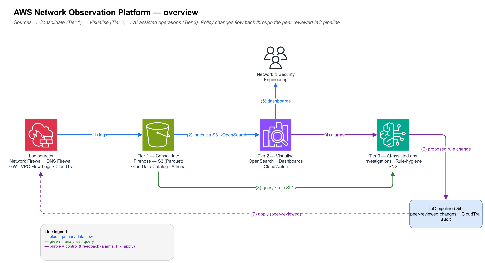

# Network Observation Platform for AWS Network Firewall

This repository contains the code for the AWS Prescriptive Guidance pattern:
**[Build a Network Observation platform for AWS Network Firewall](https://docs.aws.amazon.com/prescriptive-guidance/latest/patterns/build-a-network-observation-platform-for-aws-network-firewall.html)**.

> **Disclaimer**
>
> This is sample code, for non-production usage. You should work with your security and
> legal teams to meet your organizational security, regulatory and compliance requirements
> before deployment.

## Overview

AWS Network Firewall meets the security and routing requirements of a centralised-inspection landing zone, and it now has native monitoring — a console dashboard for a single firewall's traffic and prebuilt Amazon CloudWatch/OpenSearch dashboards per log source. Teams often want to take this a step further with a *consolidated* operational plane: one place that correlates Network Firewall with DNS Firewall, VPC and Transit Gateway flow, and CloudTrail on a common key; a link from a log entry to the rule that produced it; a report that surfaces unused rules; and an AI assistant that investigates across all of it. This pattern adds that layer, building on the native dashboards rather than replacing them.

The platform delivers three independently deployable tiers:

| Tier | What it does | Key AWS services |
|------|-------------|-----------------|
| **Tier 1 — Consolidate** | Centralise Network Firewall alert/flow logs, DNS Firewall query logs, Transit Gateway Flow Logs, VPC Flow Logs, and CloudTrail into a single analysis store. Normalise to a common schema (5-tuple + time bucket). | Data Firehose, S3, Glue, Athena |
| **Tier 2 — Visualise** | Consolidated cross-source dashboards (top talkers, allow/deny volumes, per-rule hit trends, blocked-domain leaderboard, geo map) over the unified store, plus the log-to-rule deep link. Single-firewall views use the native NFW console and prebuilt CloudWatch/OpenSearch dashboards. | OpenSearch Service, OpenSearch Dashboards, CloudWatch |
| **Tier 3 — AI-assisted ops** | AWS DevOps Agent (agent space + operator app) with a network-firefighter skill for AI-assisted investigation, alarm→SNS notification for CloudWatch investigations, and a scheduled rule-hygiene report. | AWS DevOps Agent, CloudWatch, Lambda, SNS |



The platform is delivered as three independently deployable tiers. Per-tier detail:

- [Tier 1 — Consolidate](images/tier1-consolidate.png)
- [Tier 2 — Visualise](images/tier2-visualise.png)
- [Tier 3 — AI-assisted operations](images/tier3-ai-ops.png)

> **New to AWS or Terraform?** Start with **[GETTING-STARTED.md](GETTING-STARTED.md)** — a
> plain-language guide for network engineers that explains the AWS concepts, walks one tested
> path from an empty account to a working dashboard, and lists the common first-time errors and
> how to tear everything down.

## Prerequisites

- **Terraform/OpenTofu** ≥ 1.5.0 and the **AWS** (≥ 6.0.0), **awscc** (≥ 1.98.0), **time** and **archive** providers. `awscc` and `time` are only needed for Tier 3's AWS DevOps Agent; `terraform init` installs them automatically.
- AWS credentials for the analysis account (Log Archive or Security Tooling)
- **`opensearch_master_user_arn` set to an IAM role/user ARN** (for example `arn:aws:iam::<account>:role/<Role>`) when Tier 2 is enabled. This IAM principal is granted OpenSearch `all_access` for CLI/API use. If you deploy through an assumed role or IAM Identity Center/SSO — as most AWS environments do — you **must** set this: leaving it empty falls back to your caller ARN, which is then an STS assumed-role *session* ARN that OpenSearch fine-grained access control rejects (`ValidationException: The master user ARN is not one of the allowed types`). (Human browser access to the dashboards is via Cognito — see below — not this principal.)
- An existing **AWS Network Firewall** with both flow and alert logging enabled
- **Appliance mode enabled** on the Transit Gateway inspection attachment (symmetric routing)
- (Optional) **AWS DevOps Agent** (Tier 3, on by default) — [generally available since March 2026](https://aws.amazon.com/about-aws/whats-new/2026/03/aws-devops-agent-generally-available/) — runs in a subset of AWS Regions (check the current Regions list). When the platform runs in a Region without it, its agent space is created in `devops_agent_region` (default `eu-west-1`) and still monitors this account. Set `enable_devops_agent = false` to skip it.

No build step is required — Lambda functions are zipped by the Terraform `archive` provider from the bundled source.

### Dashboards access (Cognito)

The OpenSearch domain uses fine-grained access control with an IAM master user, which means the Dashboards endpoint has **no interactive browser login** on its own. The platform therefore provisions **Amazon Cognito** (`enable_dashboards_cognito = true`, on by default) so you get a real login page. Set `dashboards_notification_email` (or `notification_email`) and Cognito emails that address an invitation with a temporary password on apply. Open the `opensearch_dashboards_url` output, sign in, and you land on the pre-loaded **Network Observation** dashboard. To front the domain with SAML / IAM Identity Center instead, set `enable_dashboards_cognito = false`.

## Quick start

### Option A: Greenfield (new account / proof of concept)

Deploy the **test harness** first to create a minimal VPC, Transit Gateway, and Network Firewall, then deploy the platform against it:

```bash
# 1. Stand up the prerequisites
cd test-harness
terraform init && terraform apply

# 2. Read the output values
terraform output platform_tfvars_snippet

# 3. Deploy the platform
cd ../terraform
#    Paste the snippet values into examples/test-harness.tfvars
terraform init
terraform apply -var-file=examples/test-harness.tfvars
```

### Option B: Brownfield (existing landing zone)

Point the platform at your existing infrastructure:

```bash
cd terraform
cp examples/brownfield.tfvars my.tfvars
# Edit my.tfvars — set the existing resource identifiers
terraform init
terraform apply -var-file=my.tfvars
```

### Post-deployment steps

`terraform apply` now completes the OpenSearch setup for you: a bootstrap Lambda (the FGAC master user) runs automatically during apply to create least-privilege OpenSearch roles and map each principal into the role it needs — your admin principal into `all_access`; the Cognito login role and the DevOps Agent into the read-only `netobs_read` role — and the Cognito login role *additionally* into the built-in `opensearch_dashboards_user` role so Dashboards works (the DevOps Agent is not granted `opensearch_dashboards_user`); and the ingestion pipeline and demo injector into `netobs_write` (read plus write to `network-events-*`). It then loads the index template and imports the dashboards. There are no manual OpenSearch Security console steps (which would not be reachable anyway on an IAM-master-user domain).

What's left is only what needs a human:

1. **Accept the Cognito invite.** Check the `dashboards_notification_email` inbox for the temporary password, open the `opensearch_dashboards_url` output, sign in and set a new password. You'll see the pre-loaded **Network Observation** dashboard.
2. **Confirm the SNS email subscription** if `notification_email` was set (click the confirmation link).
3. **(Tier 3, optional) Enable CloudWatch investigations.** This is a one-time, account/Region-level AWS step: enable a CloudWatch **investigation group** and associate it with your alarms so an investigation can auto-start from an alarm action. It isn't a stable Terraform resource yet, so the platform can't create it for you. The platform's half *is* already wired — `investigation_alarm_names` (plus the baseline alarms) feeds an EventBridge rule that notifies the SNS topic the moment a monitored alarm enters ALARM.
4. **(Tier 3) Use the AWS DevOps Agent** operator app to ask investigative questions — see below. The agent queries the lake with its read-only IAM role; no extra registration step is needed.

See [terraform/README.md](terraform/README.md) for detail.

### AWS DevOps Agent (Tier 3)

When `enable_devops_agent = true` (default), the platform provisions a real **AWS DevOps Agent** agent space and operator app, plus a **network-firefighter** skill/custom-agent/scheduled-trigger seeded with how to investigate this platform's telemetry (the Athena `network_events` table and the OpenSearch `network-events-*` index). Because the service is Region-limited, the agent space is created in `devops_agent_region` (default `eu-west-1`) and monitors this account.

> **Built on generally-available AWS capabilities.** Tier 3 consolidates existing AWS services rather than reinventing them. [AWS DevOps Agent](https://aws.amazon.com/about-aws/whats-new/2026/03/aws-devops-agent-generally-available/) has been generally available since March 2026, and the platform's alarm wiring complements [Amazon CloudWatch investigations](https://aws.amazon.com/about-aws/whats-new/2025/06/ga-accelerate-troubleshooting-amazon-cloudwatch-investigations/) (generally available since June 2025), which can auto-trigger from a CloudWatch alarm action — point an investigation at the platform's baseline alarms. The platform's own contribution is the consolidated cross-source lake and the network-firefighter skill layered on top of these.

To ask it questions, open the **AWS DevOps Agent console** in `devops_agent_region` → select the `network-observation` agent space → **Operator app**, and ask things like *"why did Network Firewall drops spike in the last hour?"*. The `devops_agent_space_arn` and `devops_agent_operator_role_arn` outputs identify the deployed resources.

The agent reads the consolidated lake by running `athena:StartQueryExecution`, which is a **read-only** query execution — it runs on the agent's base read-only IAM role (read Glue + S3; with the managed-query-results workgroup `netobs-agent` it needs no S3 write at all) with **no operator approval**, and never writes the consolidated Parquet. So out of the box the agent investigates the lake autonomously. Writes happen only under the elevated directed-actions role described below.

> **Note:** Some environments gate `athena:StartQueryExecution` behind approval even though the agent uses it only for read-only SELECTs. The directed-actions fallback below exists for that case: it adds per-action operator approval for Athena query execution only. The elevated role it uses grants no infrastructure, firewall-policy, or lake-data mutation.

#### Directed actions (optional fallback)

**Directed actions** give the agent an elevated role plus per-query operator approval. You only need this if query execution is still gated in your environment. The elevated role is scoped to the Athena query path only — Athena query execution, Glue/S3 reads, KMS use, and writing query results solely under the `athena-results/` prefix; it grants no permission to change infrastructure, firewall policy, or the consolidated lake data. Terraform creates it (`devops_agent_elevated_role_arn`, gated by `devops_agent_directed_actions`), but **enabling directed actions and registering the role are not yet exposed by the `awscc` provider**, so run these two AWS CLI steps once after apply (Region = `devops_agent_region`):

```bash
# 1. Enable directed actions on the agent space
aws devops-agent update-agent-space \
  --agent-space-id <AGENT_SPACE_ID> \
  --preferences elevatedActionsEnabled=true --region <REGION>

# 2. Register the elevated role on the AWS-account association
#    (get the association ID from `aws devops-agent list-associations`)
aws devops-agent update-association \
  --agent-space-id <AGENT_SPACE_ID> --association-id <ASSOCIATION_ID> \
  --configuration '{"aws":{"accountId":"<ACCT>","accountType":"monitor","assumableRoleArn":"<AGENTSPACE_ROLE_ARN>","agentElevatedRoleArn":"<ELEVATED_ROLE_ARN>"}}' \
  --region <REGION>
```

Confirm `agentElevatedRoleArnStatus` is `valid`. With directed actions enabled, a gated operation pauses with an **approval request** in the Operator app; click **Approve** and it runs, attributed to you in CloudTrail. `devops_agent_directed_actions = false` (or simply leaving directed actions unregistered) keeps the agent read-only — which is all it needs for lake investigation.

## Repository structure

```
.
├── terraform/                          # Main platform Terraform
│   ├── main.tf                         # Wires the three tier modules
│   ├── variables.tf                    # All inputs (create_*/existing_* toggles)
│   ├── outputs.tf                      # Key resource identifiers
│   ├── providers.tf, locals.tf, kms.tf
│   ├── examples/
│   │   ├── greenfield.tfvars           # New account — create everything
│   │   ├── brownfield.tfvars           # Existing landing zone — reference resources
│   │   ├── hardened.tfvars             # Hardened profile — VPC, audit logs, MFA, CloudTrail
│   │   └── test-harness.tfvars         # Values from the test harness
│   └── modules/
│       ├── tier1-consolidation/        # Firehose, S3, Glue, Athena, subscriptions
│       ├── tier2-visualisation/        # OpenSearch, Cognito login, dashboards, auto-bootstrap, CloudWatch, DX health
│       ├── tier3-ai-ops/              # Alarm→SNS notification, rule hygiene
│       ├── devops-agent/              # AWS DevOps Agent: agent space, operator app, network-firefighter skill (Tier 3)
│       ├── s3-to-opensearch/          # OpenSearch Ingestion pipeline (S3 Parquet → OS)
│       └── demo-data-injector/        # Optional scheduled synthetic data Lambda
├── test-harness/                       # Minimal VPC + TGW + NFW for single-account PoC
├── tools/
│   ├── mock-data-generator/            # CLI synthetic telemetry generator
│   └── opensearch-setup/               # map_fgac_roles.py — map IAM roles into an OpenSearch FGAC role via SigV4
├── images/                             # Architecture diagrams (.drawio sources + .png exports)
│   ├── architecture-overview.drawio    # High-level 5-stage flow
│   ├── tier1-consolidate.drawio        # Tier 1 detail
│   ├── tier2-visualise.drawio          # Tier 2 detail
│   └── tier3-ai-ops.drawio             # Tier 3 detail
├── CONTRIBUTING.md
├── CODE_OF_CONDUCT.md
├── LICENSE                             # MIT-0
├── NOTICE
└── SECURITY.md
```

## Configuration

Deploy tiers independently by toggling:

| Variable | Default | Description |
|----------|---------|-------------|
| `enable_tier1_consolidation` | `true` | Log consolidation (Firehose, S3, Glue, Athena) |
| `enable_tier2_visualisation` | `true` | Dashboards (OpenSearch, CloudWatch) |
| `enable_tier3_ai_ops` | `true` | Rule hygiene, alarm→SNS notification |
| `enable_devops_agent` | `true` | AWS DevOps Agent: agent space + operator app + network-firefighter skill (deployed in `devops_agent_region`, default `eu-west-1`) |
| `enable_dashboards_cognito` | `true` | Cognito browser login for OpenSearch Dashboards |
| `enable_opensearch_ingestion` | `true` | S3 → OpenSearch indexing pipeline |
| `enable_demo_data_injector` | `false` | Synthetic data Lambda (demo/PoC only) |

Every external dependency follows the **existing-vs-new** pattern:

- `create_<thing> = true` → the platform provisions the resource
- `create_<thing> = false` + `existing_<thing>_...` → the platform references the existing resource

See [terraform/variables.tf](terraform/variables.tf) for the full list of inputs.

## Hardening options

The defaults are tuned for a low-friction proof of concept. To evaluate stricter settings, use
the hardened example in **[terraform/examples/hardened.tfvars](terraform/examples/hardened.tfvars)**
(`tofu apply -var-file=examples/hardened.tfvars`). Some controls are **on by default
everywhere** because they are additive and low-cost; the rest are **opt-in** and switched on
together by the example.

| Control | Default | Hardened example | Notes |
|---|---|---|---|
| S3 server access logging (analysis bucket) | **on** | on | Delivered to a dedicated SSE-S3 log bucket; `existing_access_log_bucket_name` to reuse a central one |
| OpenSearch `AUDIT_LOGS` | **on** | on | Data-plane access/auth trail (requires FGAC, which is enabled) |
| OpenSearch endpoint | public + FGAC | **VPC (private)** | `opensearch_subnet_ids` — see the reachability note below |
| Cognito MFA + advanced security | off | **on** | `enable_cognito_mfa`; TOTP MFA + threat protection on Dashboards login |
| CloudTrail S3 data events | off | **on** | `enable_cloudtrail_data_events`; per-object, IAM-attributed access (billed per event) |
| OpenSearch slow logs | off | **on** | `enable_opensearch_slow_logs`; query-latency forensics |
| Audit-log retention | 365 days | 365+ | `audit_log_retention_days`; raise to match your policy |

**VPC endpoint reachability.** When the OpenSearch domain is VPC-attached, its endpoint is
private (resolvable only inside the VPC). Browser users reach OpenSearch Dashboards via VPN,
Direct Connect, a bastion, or a reverse proxy; Cognito login still applies, but only for users
who can already reach the endpoint.

**Assumed org/account prerequisites** (this platform does *not* create these — they are
landing-zone responsibilities): an organization CloudTrail (management events), AWS Config,
Amazon GuardDuty, AWS Security Hub, and IAM Access Analyzer. For tamper-proof audit retention,
consider enabling **S3 Object Lock** on the access-log and CloudTrail buckets (a deliberate,
irreversible per-policy choice, so it is not wired into the profile).

## Seeding a demo account

A fresh account has no traffic, so the dashboards start empty. Two options:

- **One-shot:** run `tools/mock-data-generator/generate_events.py` against the Firehose stream and OpenSearch endpoint outputs, and (with `--flow-logs-bucket`) a dedicated synthetic/demo bucket — never the real Network Firewall flow-log bucket. The flow-log flag populates the `nfw_flow_s3` table only when the Glue catalog points at that demo bucket.
- **Continuous:** set `enable_demo_data_injector = true` for a scheduled Lambda that keeps the demo looking live (disable before production traffic flows).

## Possible extensions

The platform deliberately keeps a focused core. Two capabilities are natural follow-ons that a team can build on top of the consolidated lake, and may be covered by a future pattern:

- **Executive dashboards in Amazon Quick Sight.** The consolidated Parquet in the analysis bucket is already catalogued in AWS Glue, so it can be queried directly from Amazon Quick Sight (the BI capability of Amazon Quick Suite, formerly Amazon QuickSight). Enable it in the account, point a Quick Sight Athena data source at the `network_events` table, and build the executive analyses you need. This is an add-on to the operational OpenSearch and CloudWatch dashboards, not a replacement.
- **Assisted rule authoring.** The DevOps Agent already recommends rule changes during an investigation. A team can extend that into a workflow that drafts a Suricata rule from an approved decision and opens a pull request against the firewall-rules IaC repository for human review — keeping every change on the peer-reviewed, CloudTrail-audited path.

## Responsible AI

Tier 3's AI assistance is the **AWS DevOps Agent** with the **network-firefighter** skill. It is an *investigative aid*, scoped deliberately so a human stays in control of every change.

- **Purpose and scope.** The agent answers operator questions about this account's network telemetry — the consolidated Athena `network_events` table and the OpenSearch `network-events-*` index. It summarises, correlates, and explains; it is not a control plane and does not enforce or alter firewall policy.
- **Human in the loop.** Investigation is operator-initiated from the DevOps Agent operator app, with one exception: when the network-firefighter assets are enabled (`devops_agent_enable_assets`, on by default) a scheduled trigger also runs the agent automatically once a day (`devops_agent_trigger_schedule`, default `rate(1 day)`) for a proactive sweep. Set `devops_agent_enable_assets = false` to remove the scheduled run so every investigation is operator-initiated. In all cases the agent's base role is read-only; the optional **directed-actions** role adds only approval-gated Athena query execution (writing query results solely under the `athena-results/` prefix), never infrastructure, firewall-policy, or lake-data changes, and every directed action pauses for per-action operator approval before executing. Rule-change recommendations are drafts for human review, never applied automatically.
- **Least privilege by default.** Out of the box the agent runs on a **read-only** base IAM role (read Glue + S3; with the managed-query-results workgroup it needs no S3 write) and investigates with no mutating permissions over the lake. The elevated/directed-actions role is opt-in (`devops_agent_directed_actions`), may write only to the Athena results prefix, and is still per-action approval-gated.
- **Data handling.** The agent operates on your telemetry inside your account to answer your questions. The data it reads is the network-flow and firewall-log data already stored in your analysis account, encrypted at rest with the platform CMK; its processing stays within the AWS DevOps Agent service boundary and, per AWS's service terms, is not used to train the underlying foundation models. Review the AWS DevOps Agent documentation for the service's data-handling and Region terms.
- **Transparency and auditability.** Every query the agent runs is a logged `athena:StartQueryExecution` call attributable in **AWS CloudTrail**; approved directed actions are attributed to the approving operator. You can reconstruct exactly what the agent read and what it was permitted to do.
- **Limitations.** Agent output is probabilistic and can be incomplete or wrong. Treat its findings as a starting point, verify against the underlying logs before acting, and keep rule changes on your peer-reviewed, CloudTrail-audited change path.

## Security

See [CONTRIBUTING](CONTRIBUTING.md#security-issue-notifications) for more information.

## License

This library is licensed under the MIT-0 License. See the [LICENSE](LICENSE) file.
